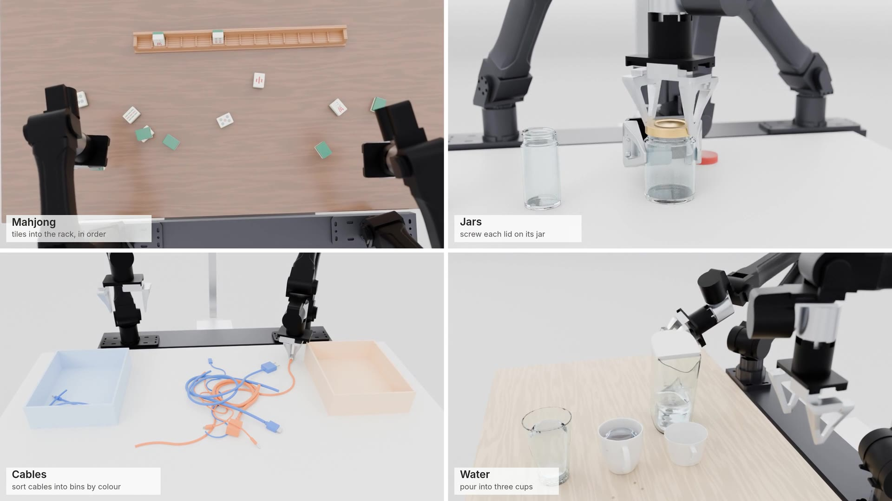

# YAM arcade

Four tables, four manipulation puzzles, four wheeled bimanual [I2RT YAM](https://github.com/i2rt-robotics/i2rt) carts.
Everything on the tables is simulated (Genesis with libuipc IPC and SPH, plus Newton for the cables), and the robots
act only through joint PD targets, IK and gripper commands. The clips are rendered in Blender.

[](https://github.com/zzigak/yam-arcade/releases/download/v0.1/grid_1080.mp4)

Click the image for the 65 s grid video (1080p). The [v0.1 release](https://github.com/zzigak/yam-arcade/releases/tag/v0.1)
has the per-station clips, the station exports (trajectories and meshes) and the full-resolution SAM 3D meshes.

## Stations

| station | task | robot | simulator | result |
|---|---|---|---|---|
| **Mahjong** | 14 riichi tiles scattered on the table, some face down or stacked; stand them in a slotted rack, sorted into the hand | YAM | Genesis rigid solver | The robot racks 3 of the 14 tiles, including a face-down 中 that it flips with a two-arm regrasp. The fully solved rack also holds still on its own. 38/38 checks pass. |
| **Jars** | three glass jars (spice, jam, mason) with real helical threads; screw each loose lid onto the jar it fits | YAM Pro | Genesis + libuipc (exact mesh contact) | All three lids are screwed on and seated 0.19 mm above the rim after 1.09-1.12 turns. A separate torque test gives a descent per turn within 0.26 % of each thread pitch. 64/64 checks pass. |
| **Cables** | 8 cables of different stiffness with curled rest shapes and plugs, dropped into a tangle; sort them by colour into two bins | YAM Ultra | Newton (main), Genesis + libuipc (comparison) | Newton: 116 crossings, 5 interlocked pairs; the robot sorts 2 cables fully into the right bins. Genesis: the drop passes all its checks, but the robot sort is partial (one cable 52 % in). |
| **Water** | a filter pitcher with 1.2 L of water and three cups of different shape; pour into all three | Big YAM | Genesis SPH + rigid | 365 / 279 / 186 ml in the pint glass / mug / teacup (about 68 % of each brim volume), 0.4 ml spilled. |

Each station's `stations/<name>/NOTES.md` gives every parameter with a reason, the run commands, the results and the
known issues. `out/<name>/checks.json` holds every check with its value, limit and pass/fail.

### Ground rules

- **Nothing is scripted on the objects.** No teleports, no kinematic stand-ins, no hidden pins.
- **Drives are disclosed.** Where a feasibility test drives an object directly (the jar torque test, the water
  "oracle" pour), it says so in the notes and the checks.
- **Checks are numeric.** Interpenetration, stretch, drift, volume conservation and similar, all measured from the
  recorded state.

### Known limitations (short list; details in each NOTES.md)

- **Mahjong:** the demo racks 3 of the 14 tiles, not all of them.
- **Jars:**
  - The robot knows the thread phase; it does not search for the thread start.
  - The lids are tightened only to seated (0.25 N·m wrist cap).
  - Drawn fingertips sit up to 3.6 mm from Genesis's own fingertip links.
- **Cables (Newton):**
  - Contact is a penalty model (up to 0.76 mm overlap).
  - The arms are kinematic.
  - One stiffness serves for both bending and twist.
- **Water:**
  - Viscosity is about 300× real water, the stability floor at 4 mm particles.
  - The pitcher creeps 12 mm down the grip while carried.
  - The controller reads cup fill levels from the sim.

## Layout

```
layout.py, export.py, SPEC.md   shared frames/table/robot mount, the Recorder export format, the project spec
robots/                         wheeled YAM cart module (yam_cart.py) + build_models.py (MJCF from I2RT's models)
stations/<name>/                station code + NOTES.md   (mahjong, jars, cables [Genesis], cables_newton, water)
assets/sam3d/                   SAM 3D Objects meshes from CC-licensed photos (INDEX.md: sizes, sources, licences)
out/<name>/                     checks.json, results and stills (trajectories and meshes are in the release)
render/                         Blender compositor (compose.py), per-station camera moves (clips.py), grid (grid.py)
site/                           page builder (build_site.py) and the three.js replay viewer (site/viewer/)
codeagent/                      the same four stations as cases for the genesis-world code agent
tools/                          cluster launcher scripts (Slurm)
```

## Setup

The code was run on Linux with an RTX 5090 and on a Slurm cluster (L40S / TITAN RTX).

**Pinned versions.** Paths in the scripts assume `~/simquarry/genesis-world` and `~/sims/newton`; adjust to taste.

| dependency | version |
|---|---|
| Genesis | [simquarry/genesis-world](https://github.com/simquarry/genesis-world), branch `ipc_rod_and_mpm` at `c4e7dd9` (Genesis 1.3.1 + libuipc / pyuipc 0.0.26) |
| Newton | [newton-physics/newton](https://github.com/newton-physics/newton) at `c5e5575` (newton 1.5.0.dev0, warp 1.15.0.dev) |
| I2RT robot models | [i2rt-robotics/i2rt](https://github.com/i2rt-robotics/i2rt) at `120c3c8` (MIT) |
| Blender | 5.2 |

**Robot models:**

```bash
git clone https://github.com/i2rt-robotics/i2rt assets/i2rt_upstream
git -C assets/i2rt_upstream checkout 120c3c8
python robots/build_models.py      # writes assets/robots/yam_cart_<variant>.xml + meshes
```

Generated files (robot MJCFs, the water station's container MJCFs) embed absolute paths. Regenerate them on a new
machine rather than copying them.

**Run a station:** see the run block at the top of `stations/<name>/run.py` and the NOTES. For example:

```bash
cd stations/jars && ~/simquarry/genesis-world/.venv/bin/python run.py robot
```

**Render:**

```bash
blender -b -P render/compose.py -- --path render/clips.py --clip <station> --out render/frames/fly_<station>   # frames
python3 render/grid.py clip <station> render/frames/fly_<station>   # -> site/media/<station>_fly.mp4
python3 render/grid.py grid                                          # -> site/media/grid.mp4 + grid_1080.mp4
```

`render/sc_render.sh` splits the frames into resumable chunks on a Slurm cluster. `compose.py --help` lists the
resolution, sample and frame-range options.

## Licences

- **Code:** MIT (see `LICENSE`).
- **SAM 3D meshes** in `assets/sam3d/`: each derives from a photo under its own licence, listed with author and link in
  `assets/sam3d/INDEX.md`. Most are CC BY 2.0 / CC0 / public domain. `tumbler_curvy` is from a CC BY-SA 2.0 photo and
  `urn` from a CC BY-NC-SA 2.0 photo (non-commercial). Keep those terms when reusing the meshes.
- **Robot models** come from I2RT's MIT-licensed repo and are not vendored here.
